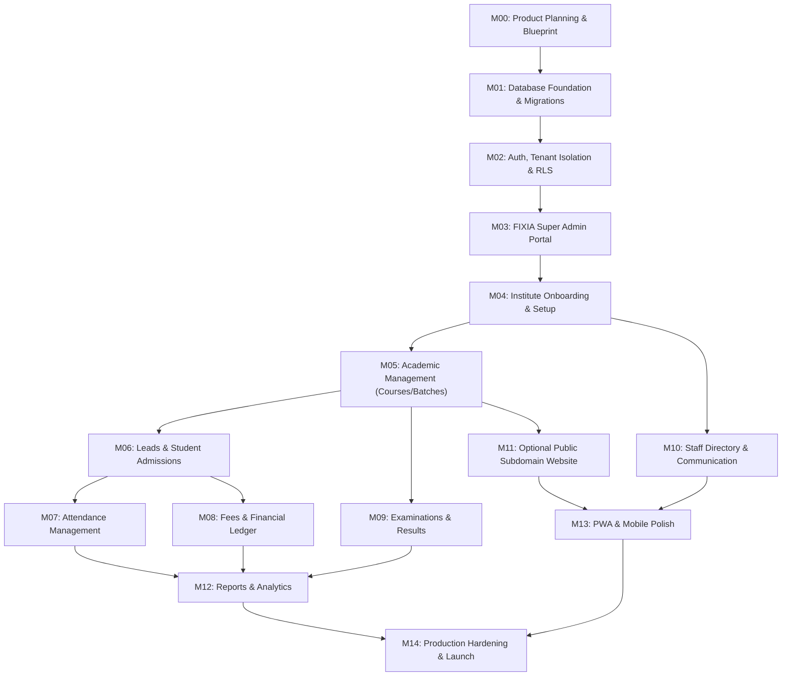

# FIXIA EduOS — Development Roadmap & Milestone Specification

**Document Version:** 1.0.0  
**Status:** Approved Architecture Baseline  
**Target Platform:** FIXIA EduOS Multi-Tenant SaaS  
**Author:** Principal Software Architect & Engineering Lead  

---

## 1. Executive Strategy & Recommended Build Sequence

The development lifecycle of **FIXIA EduOS** strictly follows a security-first, foundation-before-facade methodology. In multi-tenant educational enterprise software handling sensitive student demographics, financial ledgers, and academic assessments, user interface polish without verified row-level security and strict data isolation is catastrophic.

### The Foundation Sequence (M00 → M04)
```
┌─────────────────┐       ┌─────────────────┐       ┌─────────────────┐
│  M00: Product   │  ───> │  M01: Database  │  ───> │ M02: Auth & RLS │
│  & Architecture │       │  & Migrations   │       │ Tenant Security │
└─────────────────┘       └─────────────────┘       └─────────────────┘
                                                             │
                                                             ▼
┌─────────────────┐       ┌─────────────────┐       ┌─────────────────┐
│  M05: Academic  │  <─── │ M04: Institute  │  <─── │ M03: FIXIA      │
│   Management    │       │   Onboarding    │       │   Super Admin   │
└─────────────────┘       └─────────────────┘       └─────────────────┘
```

The application layers are built in strict order:
1. **Core Data & Tenant Isolation**: Solidify the database schema, foreign keys, triggers, and PostgreSQL kernel-level Row-Level Security (RLS) policies.
2. **Platform Governance**: Construct the FIXIA Super Admin control plane first so that institutes, subscriptions, quotas, and feature flags can be provisioned and audited.
3. **Institute Onboarding**: Build the dual-entry onboarding workflows (Super Admin manual provisioning + public self-registration).
4. **Operational Domains**: Layer on Academic Management, Student Lifecycle, Attendance, Financials, Examinations, and Staff.
5. **Extended Channels**: Deploy Public Subdomain Websites, Analytics, PWA, and final Production Hardening.

---

## 2. 16-Point EduOS Release Readiness Checklist

Every milestone contributes towards satisfying the 16 non-negotiable release readiness criteria. Production launch cannot occur until all 16 items have passed automated verification:

| # | Acceptance Criterion | Milestone Gate | Status | Verification Method |
|---|---|---|---|---|
| **01** | FIXIA Super Admin can provision an institute and invite its owner via signed JWT email | M03, M04 | `[ ] Pending` | E2E Playwright test: Platform Admin creates institute; invitation token arrives, owner creates password and logs in. |
| **02** | New coaching institute can self-register securely with automatic tenant isolation | M04 | `[ ] Pending` | Integration test: Public `/register` creates `tenants`, `tenant_subscriptions` (trial), and `profiles` without privilege escalation. |
| **03** | Institute Owner can configure workspace settings, branding, academic terms, and branches | M04, M05 | `[ ] Pending` | Cypress/Vitest test verifying `tenant_settings` mutation restricted to `owner`/`admin` role. |
| **04** | A single user (email) can belong to multiple institutes with independent roles | M02 | `[ ] Pending` | Unit & RLS test: User X is `teacher` in Tenant A and `admin` in Tenant B. Context switcher toggles `active_tenant_id`. |
| **05** | Strict Tenant Isolation: Tenant A cannot read, query, or mutate Tenant B records | M02 | `[ ] Pending` | Negative RLS matrix test: Authenticated user A queries `students`, `payments`, `batches` belonging to Tenant B; returns 0 rows. |
| **06** | Teachers can access only assigned batches, student rosters, and attendance sessions | M02, M07 | `[ ] Pending` | Database kernel test: User with `teacher` role selects `payments` (0 rows) and unassigned `batch_enrollments` (0 rows). |
| **07** | Parents/Students can access only linked student records and public notices | M02, M08 | `[ ] Pending` | RLS test: Parent P queries `student_guardians` for unlinked Student S; returns 0 rows. |
| **08** | Student admission, guardian linkage, and batch allocation work atomically | M06 | `[ ] Pending` | Integration test: Atomic admission transaction creates `students`, `student_guardians`, `student_fee_accounts`, and `batch_enrollments`. |
| **09** | Attendance can be recorded in bulk, audited, and locked against historical tampering | M07 | `[ ] Pending` | E2E test: Teacher marks 30 students; Owner views summary; edit requires explicit audit reason stored in `audit_logs`. |
| **10** | Fee collection, installments, receipts, and paise-level financial integrity work accurately | M08 | `[ ] Pending` | Invariant math test: Sum of `payment_allocations` matches `payments.amount_paise`. Immutable receipt generation with zero float rounding. |
| **11** | Examination schedules, marks entry, pass/fail grading, and report cards publish securely | M09 | `[ ] Pending` | Functional test: Teacher enters marks $\le$ `max_marks`; published results visible to students; draft results hidden. |
| **12** | FIXIA Platform can dynamically enable/disable plan features and enforce student quotas | M03 | `[ ] Pending` | Constraint test: Super Admin disables `feature_examinations`; institute UI locks route and API returns 403 Forbidden. Quota trigger blocks excess admissions. |
| **13** | Subscription expiry or downgrade locks write access without deleting tenant records | M03, M04 | `[ ] Pending` | State machine test: Expired tenant enters `past_due`/`suspended` status; reads permitted for grace period; mutations blocked. |
| **14** | Optional institute public websites render on subdomains (`<slug>.fixia.in`) based on plan | M11 | `[ ] Pending` | Subdomain resolution test: Visitor accesses `apex.fixia.in`; receives public static site; private tenant routes inaccessible. |
| **15** | Mobile and PWA workflows support offline-safe asset caching and responsive touch targets | M13 | `[ ] Pending` | Lighthouse PWA audit $\ge 95$; service worker caches app shell; shows network retry indicator during disconnection. |
| **16** | Comprehensive automated test suite passes with zero errors, zero leaks, and clean build | M14 | `[ ] Pending` | CI/CD verification gate: 100% passing Vitest suite (Target: $\ge 250$ tests), zero TypeScript compilation errors, zero ESLint/Oxlint warnings. |

---

## 3. Detailed Milestone Specifications (M00 — M14)

### Milestone M00: Product Planning & Repository Foundation
* **Current Status:** In Progress (Active)
* **Objective:** Establish the complete product vision, architectural specifications, database models, security invariants, development roadmap, and architectural decision records. Audit existing codebase to ensure zero regressions.
* **Deliverables:**
  1. `docs/PRODUCT_REQUIREMENTS.md` (Complete PRD, 3 experiences, 8 user journeys, 12 functional domains).
  2. `docs/SYSTEM_ARCHITECTURE.md` (Modular monolith, topology, tech stack, data flow).
  3. `docs/USER_ROLES_AND_PERMISSIONS.md` (Platform vs. Institute roles, granular permission matrix).
  4. `docs/DATABASE_DESIGN.md` (Schema specs, integer paise standard, constraints, triggers).
  5. `docs/SECURITY_MODEL.md` (RLS policies, JWT claims, zero service-role secret client rule).
  6. `docs/DEVELOPMENT_ROADMAP.md` (Detailed milestone plan and 16-point readiness checklist).
  7. `docs/DECISIONS.md` (ADR-001 through ADR-009).
* **Verification Gate:**
  - All 7 specification documents reviewed and approved.
  - Zero modifications to existing working test suite (170/170 tests passing).
  - Production build compiles cleanly with zero errors.

---

### Milestone M01: Supabase Database Foundation & Migrations
* **Prerequisites:** M00 completion and architectural sign-off.
* **Objective:** Author and apply clean, idempotent, forward-compatible SQL migrations establishing the full multi-tenant relational schema on Supabase PostgreSQL.
* **Scope & Schema Areas:**
  - **Platform Tables:** `profiles`, `platform_admins`, `tenants`, `tenant_memberships`, `branches`, `branch_memberships`, `invitations`, `audit_logs`.
  - **Subscription Tables:** `plans`, `plan_versions`, `features`, `plan_features`, `tenant_subscriptions`, `tenant_entitlements`, `subscription_events`, `platform_payments`, `platform_invoices`, `platform_settings`.
  - **Academic Tables:** `academic_sessions`, `courses`, `subjects`, `course_subjects`, `batches`, `batch_schedules`, `batch_enrollments`, `teacher_assignments`.
  - **Student & Guardian Tables:** `leads`, `lead_followups`, `students`, `guardians`, `student_guardians`, `student_documents`, `student_status_history`.
  - **Operations & Finance Tables:** `attendance_sessions`, `attendance_records`, `fee_structures`, `student_fee_accounts`, `fee_installments`, `payments`, `payment_allocations`, `refunds`, `fee_adjustments`, `receipts`.
  - **Examination Tables:** `examinations`, `exam_subjects`, `exam_enrollments`, `exam_results`.
  - **Staff & Communication Tables:** `staff_profiles`, `notices`, `notifications`, `notification_preferences`.
  - **Website Tables:** `website_settings`, `website_pages`, `website_enquiries`.
* **Deliverables:**
  - Sequential migrations in `supabase/migrations/` (e.g. `008_eduos_core_schema.sql`).
  - Strict constraints: UUID primary keys, composite foreign keys `(tenant_id, id)`, `CHECK` constraints on integer amounts ($\ge 0$), status enums.
  - Student quota enforcement trigger `trg_check_student_quota` on `students`.
  - Automated `updated_at` triggers on all mutable tables.
  - Development seed scripts in `supabase/seed.sql` with zero fake production credentials.
* **Verification Gate:**
  - Migrations execute cleanly against local and test Supabase instances.
  - Foreign key cascades and check constraints verified with positive and negative SQL unit tests.

---

### Milestone M02: Authentication, Tenant Security & RLS
* **Prerequisites:** M01 database migrations applied.
* **Objective:** Implement complete end-to-end authentication, multi-tenant workspace context switching, and bulletproof PostgreSQL Row-Level Security (RLS) policies on every exposed table.
* **Scope:**
  - Supabase Auth integration (email/password, password reset, session refresh, email verification).
  - Multi-tenant session state: Client-side storage of active institute with server-side validation against `tenant_memberships`.
  - Security Helper Functions (`SECURITY INVOKER` / audited `SECURITY DEFINER`):
    * `public.is_tenant_member(target_tenant_id uuid)`
    * `public.get_tenant_role(target_tenant_id uuid)`
    * `public.is_platform_super_admin()`
    * `public.is_teacher_assigned(target_tenant_id uuid, target_batch_id uuid)`
  - RLS Policies for every single exposed table ensuring cross-tenant leakage is physically impossible.
  - Negative Security Test Suite verifying:
    * Tenant A user cannot read Tenant B rows.
    * Teacher cannot view payments, fee accounts, expenses, or unassigned batches.
    * Student/Parent cannot read other students' records or financial data.
    * Receptionist cannot view platform plans or modify subscription entitlements.
    * Institute Owner cannot access Super Admin governance routes or tables.
* **Deliverables:**
  - `src/lib/auth/`: Tenant context provider, role-based route guard, permission check hooks.
  - Supabase migration: `009_eduos_rls_policies.sql`.
  - Vitest test suite: `src/tests/security-rls.test.ts` executing 30+ negative authorization assertions.
* **Verification Gate:**
  - 100% passing tests on negative authorization matrix.
  - Zero RLS bypasses. Zero service-role keys bundled into client assets.

---

### Milestone M03: FIXIA Super Admin Application
* **Prerequisites:** M02 authentication and security foundation complete.
* **Objective:** Construct the isolated platform administration portal (`/superadmin/*`) allowing FIXIA operators to manage institutes, commercial plans, feature entitlements, quotas, and platform audit logs.
* **Scope:**
  - **Super Admin Dashboard:** Total institutes, active vs. trial vs. suspended, active student count across platform, monthly recurring revenue (MRR) in paise.
  - **Institute Management:** Institute directory, search, filter by state/tier, manual institute provisioning modal, status switcher (Active, Grace Period, Suspended, Archived).
  - **Subscription & Quota Engine:** Create/edit plans, define student quotas (e.g. 100, 500, 2500, unlimited), toggle feature flags per tenant (`feature_online_attendance`, `feature_examinations`, `feature_public_website`).
  - **Platform Audit Logs:** Immutable stream of operator actions (who changed what plan, when, and rationale).
* **Deliverables:**
  - React pages under `src/pages/superadmin/`: `SuperAdminDashboard`, `SuperAdminInstitutes`, `SuperAdminSubscriptions`, `SuperAdminAuditLogs`.
  - Platform data service: `src/services/platformAdminService.ts`.
  - End-to-end Vitest tests for Super Admin workflows.
* **Verification Gate:**
  - Only users with verified `platform_admins` records can mount `/superadmin/*`.
  - Non-platform users navigating to `/superadmin` are redirected to `/login` with 403 Forbidden.

---

### Milestone M04: Institute Onboarding & Initial Setup
* **Prerequisites:** M03 Super Admin capabilities active.
* **Objective:** Implement both onboarding paths: FIXIA-managed owner invitation acceptance and self-service public registration, culminating in the first-run Setup Wizard.
* **Scope:**
  - **Path A (FIXIA-Managed):** Owner clicks email invite link with cryptographic token, sets initial password, profile is initialized, and workspace opens.
  - **Path B (Self-Registration):** Public sign-up at `/register`, automatic tenant creation, provisioning of trial subscription in `tenant_subscriptions` with default feature set, creator assigned `owner` role.
  - **Setup Wizard (4 Steps):**
    1. Institute Details (Legal name, institute type, contact, branding logo, time zone, currency: INR).
    2. Academic Session Initialization (e.g. "2026–2027", start/end dates).
    3. Branch Configuration (Primary branch name, physical address, city, state).
    4. First Course & Batch Creation (Name, subject list, enrollment limit).
* **Deliverables:**
  - `src/pages/auth/RegisterInstitute.tsx`, `src/pages/auth/AcceptInvitation.tsx`.
  - `src/pages/owner/SetupWizard.tsx`.
  - Invitation verification service and token validator.
* **Verification Gate:**
  - New institute creation leaves workspace fully functional with default academic session and primary branch.
  - Trial expiration date and student quota correctly populated from system defaults.

---

### Milestone M05: Academic Management Domain
* **Prerequisites:** M04 onboarding complete.
* **Objective:** Implement academic hierarchy management: Academic Sessions, Courses, Subjects, Batches, Weekly Timetables, and Classroom Room Allocations.
* **Scope:**
  - Multi-session handling (Active, Upcoming, Archived).
  - Course and Subject catalog with course-subject junction configuration.
  - Batch configuration: Max student capacity, assigned primary teacher, start/end dates, fee tier linkage.
  - Weekly Timetable Builder: Schedule matrix (Day of week, Start time, End time, Subject, Teacher, Classroom). Conflict detection for teachers and rooms.
  - Teacher Assignment: Allocate teachers to specific subjects within batches.
* **Deliverables:**
  - `src/pages/academic/`: `CoursesPage`, `BatchesPage`, `TimetablePage`, `ClassroomsPage`.
  - Academic domain services: `courseService.ts`, `batchService.ts`, `timetableService.ts`.
  - Timetable conflict validation algorithms in TypeScript.
* **Verification Gate:**
  - Overlapping batch schedule validation rejects classroom or teacher double-booking.
  - Batch capacity limits respected when enrolling students.

---

### Milestone M06: Leads & Student Lifecycle Management
* **Prerequisites:** M05 academic structure in place.
* **Objective:** Build complete student lifecycle management from initial enquiry/lead capture to admission, guardian linkage, batch assignment, profile updates, and transfer/alumni archiving.
* **Scope:**
  - **Enquiry/Lead CRM:** Lead capture form, status pipeline (New, Contacted, Demo Scheduled, Converted, Lost), follow-up reminders.
  - **Student Admission:** Form with auto-generated Roll Number, personal details, contact, blood group, academic history.
  - **Guardian Linkage:** Primary and secondary guardian names, relationship, phone, WhatsApp number, emergency contact flags.
  - **Batch Allocation & Transfer:** Enroll student into one or multiple batches; transfer student between batches with historical record maintained in `batch_enrollments`.
  - **Student Quota Verification:** Frontend warning at 90% capacity and hard block with upgrade prompt at 100% quota limit.
  - **Document Storage:** Upload ID proof, photo, previous marksheets to Supabase Storage bucket `student-documents` using signed tenant-scoped paths.
* **Deliverables:**
  - `src/pages/students/`: `StudentDirectoryPage`, `AdmissionWizard`, `StudentProfilePage`, `LeadManagementPage`.
  - Student services: `studentService.ts`, `leadService.ts`.
  - Automated quota check validation in UI and database trigger.
* **Verification Gate:**
  - Cannot admit student beyond tenant's subscription `student_quota`.
  - Storage files inaccessible to unauthenticated users or users from different tenants.

---

### Milestone M07: Attendance Operations & Audit Logging
* **Prerequisites:** M06 student rosters populated.
* **Objective:** Deliver the dual-interface attendance engine: high-speed mobile attendance terminal for teachers and institute-wide oversight/audit interface for institute owners.
* **Scope:**
  - **Teacher Mobile Attendance Terminal (`/teacher/attendance/:batchId`):**
    * Display today's student roster with Roll Number, Photo, and Student Name.
    * Quick actions: "Mark All Present", single-tap status toggle (`present`, `absent`, `late`, `excused`).
    * Live counter badges (Total, Present, Absent).
    * Pre-submission review screen.
    * Atomic session creation and attendance record batch insertion.
  - **Owner Attendance Management:**
    * Institute-wide daily attendance dashboard with heatmaps and percentage tracking.
    * Low-attendance alerts (students $< 75\%$ attendance).
    * Owner-authorized correction modal requiring a mandatory reason text field, logged into `audit_logs`.
    * Historical roster preservation (past attendance remains accurate even if students transfer batches).
* **Deliverables:**
  - Teacher terminal UI: `src/pages/teacher/AttendanceTerminal.tsx`.
  - Owner dashboard: `src/pages/attendance/AttendanceOverviewPage.tsx`, `AttendanceHistoryPage.tsx`.
  - Attendance service: `attendanceService.ts`.
* **Verification Gate:**
  - Attendance submission completes in $< 500\text{ ms}$ for 60 students on standard 4G mobile.
  - Attendance modifications strictly audited with author ID, timestamp, and rationale.

---

### Milestone M08: Fees, Payments & Financial Ledger (Paise Precision)
* **Prerequisites:** M06 student accounts and M05 courses active.
* **Objective:** Construct the mission-critical financial ledger handling fee structures, installment schedules, payments, receipts, discounts, refunds, and financial reporting—strictly in integer paise.
* **Scope:**
  - **Fee Plan Definition:** Course-level fee templates (One-time, Monthly, Quarterly, Custom installments).
  - **Student Fee Account Allocation:** Assign fee structure to enrolled student with discretionary discounts (flat or percentage).
  - **Payment Collection Terminal:**
    * Record payment against student account via Cash, UPI, Bank Transfer, Cheque, or Card.
    * Capture payment date, transaction reference number, collector staff ID, and optional remark.
    * Automated allocation to oldest outstanding fee installment.
  - **GST Compliance:** Optional GST configuration (e.g. 18% CGST/SGST) with split computation.
  - **Receipt Generation:** Instant printable receipt with institute logo, serial number, student details, breakdown, and signature space.
  - **Financial Safety:** Invariant balance verification:
    $$\text{Balance} = \sum \text{Installments} - \sum \text{Discounts} - \sum \text{Payments} + \sum \text{Refunds}$$
  - **Expense Tracking:** Institute operating expenses (Rent, Salaries, Utilities, Supplies) for Net Operating Income computation.
* **Deliverables:**
  - `src/pages/finance/`: `FeeCollectionPage`, `StudentFeeProfilePage`, `FeeStructuresPage`, `ExpensesPage`, `ReceiptViewModal`.
  - Financial domain service: `financeService.ts` using strictly integer arithmetic (`BigInt` / safe integer paise).
  - Printable receipt stylesheet and component.
* **Verification Gate:**
  - Zero floating-point drift: All balances balance to the exact single paisa.
  - Payments cannot be deleted; corrections require auditable reversal transactions.

---

### Milestone M09: Examination & Result Management
* **Prerequisites:** M05 academic structure and M06 student enrollments.
* **Objective:** Provide structured exam creation, scheduling, marks entry, automated grade calculation, and report card publishing.
* **Scope:**
  - Exam creation (Unit Test, Midterm, Final Mock, Board Prep) tied to Academic Session and Batches.
  - Subject configuration with Maximum Marks and Passing Marks.
  - Fast Marks Entry Grid: Tab-navigation marks entry for teachers with instantaneous validation ($\text{Marks} \le \text{Max Marks}$).
  - Grade Computation Engine: Customizable grading scales (A+, A, B, C, F) and percentage calculation.
  - Publishing Lifecycle: `draft` $\rightarrow$ `under_review` $\rightarrow$ `published`.
  - Student Report Card: Clean, printable PDF/print view with institute header, performance breakdown, and teacher remarks.
* **Deliverables:**
  - `src/pages/exams/`: `ExamListPage`, `MarksEntryPage`, `StudentReportCardModal`.
  - Exam service: `examService.ts` and grading utility functions.
* **Verification Gate:**
  - Un-published exam marks return 0 rows for students and parents.
  - System rejects input values greater than maximum marks with immediate inline validation error.

---

### Milestone M10: Staff Directory & Multi-Channel Communications
* **Prerequisites:** M02 RBAC and M04 onboarding.
* **Objective:** Manage institute personnel (teachers, accountants, receptionists) and establish multi-channel communication (notices, alerts, WhatsApp direct links).
* **Scope:**
  - **Staff Management:** Directory of staff members, role assignment, branch allocation, emergency contact, salary tracking.
  - **Notice Board:** Post public or role-scoped announcements (e.g. "Holiday Notice", "Test Rescheduled").
  - **In-App Notifications:** Real-time bell notification for fee dues, low attendance, and new notices.
  - **Direct WhatsApp Messaging:** Generate formatted click-to-chat `https://wa.me/<phone>?text=...` links for fee reminders, attendance alerts, and exam results without third-party API costs.
* **Deliverables:**
  - `src/pages/staff/`: `StaffDirectoryPage`, `InviteStaffModal`.
  - `src/pages/communication/`: `NoticeBoardPage`, `NotificationCenter.tsx`.
  - Utility: `src/utils/whatsappHelper.ts` for safe URL-encoded message generation.
* **Verification Gate:**
  - Staff invitations create secure records with expiring tokens; only designated roles access staff salaries.

---

### Milestone M11: Optional Public Institute Website Subdomain Generator
* **Prerequisites:** M03 entitlement engine and M05 course catalog.
* **Objective:** Enable institutes on eligible subscription plans to publish a professional marketing website hosted on a dedicated platform subdomain (`<slug>.fixia.in`).
* **Scope:**
  - **Subdomain Routing:** Detect hostname in frontend router; if matching `<tenant-slug>.fixia.in`, render the Public Website experience rather than the SaaS login.
  - **Website Builder Settings:** Theme color selection, hero headline, about text, contact address, phone, WhatsApp inquiry button, social links.
  - **Course Showcase:** Select which courses to publicly feature with syllabus overview and duration.
  - **Faculty Showcase:** Public faculty profiles with qualifications and photo.
  - **Public Lead Form:** Contact/admission enquiry form with rate-limiting and captcha/honeypot, storing leads directly into `website_enquiries` and `leads`.
  - **Entitlement Lock:** If tenant lacks `feature_public_website`, subdomain displays a standard inactive placeholder.
* **Deliverables:**
  - `src/pages/public-site/`: `PublicWebsiteHome`, `PublicCourses`, `PublicContact`.
  - `src/pages/settings/WebsiteBuilderPage.tsx`.
  - Subdomain routing handler in `src/routes/SubdomainRouter.tsx`.
* **Verification Gate:**
  - Public website exposes zero private student, attendance, or financial database records.
  - Subdomain visitor forms generate legitimate leads in the owner's CRM inbox.

---

### Milestone M12: Real-Data Reporting & Analytics Engine
* **Prerequisites:** M06 admissions, M07 attendance, and M08 financial data.
* **Objective:** Deliver executive-level analytics and exportable reports using server-side database aggregations and optimized queries.
* **Scope:**
  - **Student Growth Trends:** Monthly admissions, attrition rate, lead conversion funnel.
  - **Attendance Analytics:** Average attendance rates per batch, recurring absenteeism patterns.
  - **Financial Metrics:** Monthly collections vs. dues, revenue by course, payment method breakdown (Cash vs. UPI), expense breakdown, Net Operating Margin.
  - **Academic Performance:** Subject-wise grade distribution, top performers, batch comparison.
  - **CSV / Excel Export:** Secure data export for student rosters, fee ledgers, and attendance registers with audit logging of export events.
* **Deliverables:**
  - `src/pages/reports/`: `FinancialReportsPage`, `AttendanceReportsPage`, `StudentAnalyticsPage`.
  - SQL aggregate views configured with `WITH (security_invoker = true)`.
  - Charting components built with `recharts`.
* **Verification Gate:**
  - Aggregations execute on server/database; no fetching of thousands of raw records to client memory.
  - Export actions trigger audit log entries.

---

### Milestone M13: Progressive Web Application (PWA) & Mobile Polish
* **Prerequisites:** All core portal interfaces functional.
* **Objective:** Ensure FIXIA EduOS provides an exceptional mobile experience with PWA installation support, offline shell caching, and touch-optimized interfaces.
* **Scope:**
  - Web App Manifest: Correct name, short name, 192px and 512px icons, theme color, display mode `standalone`.
  - Service Worker: Cache static app assets (JS, CSS, fonts, SVG icons).
  - Offline Safety Rule: Safe offline shell; mutations (attendance, payments, admissions) display explicit offline warning and prevent unconfirmed optimistic state.
  - Responsive Layout Audit: 320px mobile, 768px tablet, and 1280px+ desktop verification across all screens.
* **Deliverables:**
  - `public/manifest.json`, `public/icons/`, `src/service-worker.ts`.
  - Install prompt banner component for mobile Safari and Android Chrome.
* **Verification Gate:**
  - Google Lighthouse PWA audit score $\ge 90/100$.
  - Clean touch targets ($\ge 44 \times 44\text{ px}$) across all teacher and owner actions.

---

### Milestone M14: Production Hardening, Security Pentest & Go-Live
* **Prerequisites:** M00 through M13 complete.
* **Objective:** Conduct exhaustive security audit, load testing, negative authorization testing, automated test suite completion, and launch preparation for pilot coaching institutes.
* **Scope:**
  - **Security Pentesting:** OWASP Top 10 verification, SQL injection immunity via Supabase parameterized queries, XSS sanitization, CSRF evaluation, storage bucket access controls.
  - **Negative Permission Matrix Verification:** Automated verification of every role against every table.
  - **Performance Optimization:** Database index analysis on foreign keys and compound search columns. Vite bundle size inspection.
  - **Documentation & Operational Runbooks:**
    * Comprehensive `README.md`.
    * System Deployment Guide (Vercel + Supabase).
    * Database Migration & Rollback Guide.
    * Institute Owner User Manual.
* **Deliverables:**
  - Security audit report artifact.
  - Minimum 250 passing automated tests covering all modules.
  - Production release tag `v1.0.0-eduos`.
* **Verification Gate:**
  - 16-point EduOS Release Readiness Checklist verified at 16/16.
  - Zero critical or high severity vulnerabilities.
  - Zero TypeScript compile errors and passing production build.

---

## 4. Milestone Dependency Graph



---

## 5. Milestone Execution Rules & Verification Protocol

For each milestone from M01 to M14:
1. **Inspection Before Action:** Inspect existing code, test suites, and database state. Never rewrite or destroy working components.
2. **Strict Incremental Scope:** Complete ONLY the currently assigned milestone. Never preemptively implement future milestone features without approval.
3. **Automated Verification Gate:** Every milestone must add automated tests verifying its features and ensure existing tests continue to pass.
4. **Honest Reporting:** If a technical blocker, Supabase CLI issue, or schema mismatch is encountered, report it immediately with root cause analysis.
