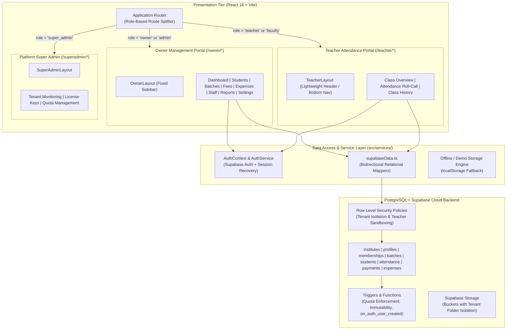
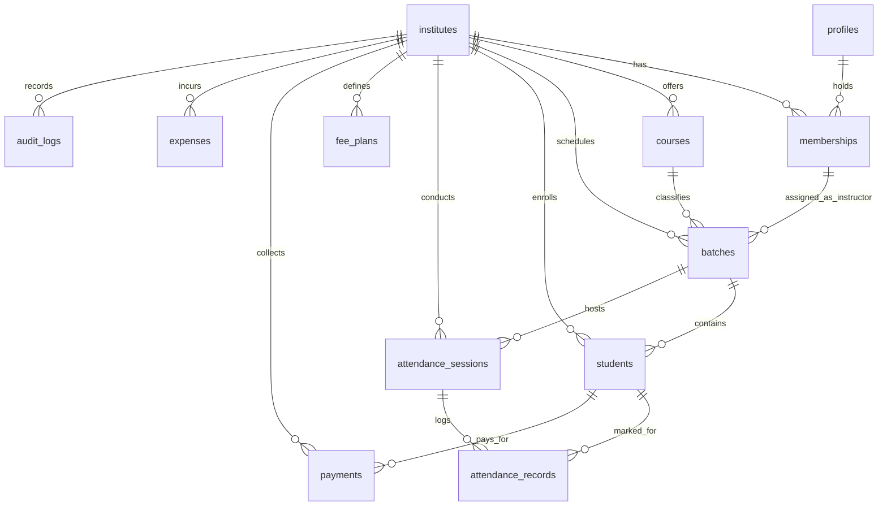

# FIXIA CoachingOS — Final Product & Technical Architecture
**Document Version:** 1.0.0  
**Phase:** 11 — Architecture & System Audit  
**Author:** Senior SaaS Product Architect & Database Architect  
**Status:** Approved Technical Architecture  

---

## 1. High-Level Architecture Overview

FIXIA CoachingOS is structured as a **Multi-Tenant Hybrid SaaS** application. The presentation tier is a React 18 Single Page Application (Vite + TypeScript), backed by a PostgreSQL database managed via Supabase with kernel-enforced Row Level Security (RLS).



---

## 2. Frontend Portal Separation

The application routes and layouts are decoupled into dedicated environments based on user role:

### 1. Route Hierarchy
```typescript
// App.tsx Route Blueprint
<Routes>
  {/* Public Authentication */}
  <Route path="/login" element={<Login />} />
  <Route path="/reset-password" element={<ResetPassword />} />

  {/* 1. Institute Owner Management Portal */}
  <Route path="/owner" element={<ProtectedRoute allowedRoles={['owner', 'admin']}><OwnerLayout /></ProtectedRoute>}>
    <Route index element={<OwnerDashboard />} />
    <Route path="students" element={<Students />} />
    <Route path="students/:id" element={<StudentProfile />} />
    <Route path="batches" element={<Batches />} />
    <Route path="attendance" element={<AttendanceManagement />} />
    <Route path="fees" element={<FeesAndLedger />} />
    <Route path="expenses" element={<ExpensesManagement />} />
    <Route path="staff" element={<StaffManagement />} />
    <Route path="reports" element={<ReportsAndExports />} />
    <Route path="settings" element={<ProtectedRoute allowedRoles={['owner']}><InstituteSettings /></ProtectedRoute>} />
  </Route>

  {/* 2. Teacher Class Attendance Portal */}
  <Route path="/teacher" element={<ProtectedRoute allowedRoles={['teacher', 'faculty', 'staff']}><TeacherLayout /></ProtectedRoute>}>
    <Route index element={<TeacherClassOverview />} />
    <Route path="attendance/:batchId" element={<TeacherAttendanceTerminal />} />
    <Route path="history" element={<TeacherAttendanceHistory />} />
  </Route>

  {/* 3. FIXIA Super Admin Portal (Platform-Level) */}
  <Route path="/superadmin" element={<ProtectedRoute allowedRoles={['super_admin']}><SuperAdminLayout /></ProtectedRoute>}>
    <Route index element={<TenantOverview />} />
    <Route path="licenses" element={<LicenseManager />} />
    <Route path="quotas" element={<QuotaController />} />
  </Route>

  {/* Dynamic Root Redirection */}
  <Route path="/" element={<RoleBasedRedirect />} />
  <Route path="*" element={<Navigate to="/" replace />} />
</Routes>
```

### 2. Layouts
- **`OwnerLayout`:** Fixed desktop sidebar with operations, financial intelligence, administration sections, institute switcher, and director profile footer.
- **`TeacherLayout`:** Ultra-clean, distraction-free interface. Clean header with assigned batch pills, current lecture indicator, and high-visibility attendance buttons. No financial links, no revenue badges, no institute configuration.
- **`SuperAdminLayout`:** Platform management shell with cross-tenant analytics and license generation tools.

---

## 3. Database Architecture & Complete Relational Model

The database is built on PostgreSQL 15+ hosted on Supabase. Every domain table contains `institute_id UUID NOT NULL REFERENCES public.institutes(id) ON DELETE CASCADE`.



### Table Definitions & Roles

| Table | Purpose & Tenant Isolation Key | Access Level |
| :--- | :--- | :--- |
| `public.institutes` | Tenant root record (name, category, address, session, branding). | Owner: Update; Members: Select. |
| `public.profiles` | User identity linked directly to `auth.users(id)`. | Self: Update; Peers: Select. |
| `public.memberships` | Role mapping (`owner`, `admin`, `teacher`) and `assigned_batches JSONB`. | Owner: Full CRUD; Admin: Staff CRUD; Teacher: Select self. |
| `public.courses` | Academic programs (e.g. "Class 12 CBSE", "JEE Advanced"). | Owner/Admin: Full; Teacher: Select. |
| `public.batches` | Cohorts with schedules, rooms, capacity, and `instructor_user_id`. | Owner/Admin: Full; Teacher: Select assigned only. |
| `public.batch_schedules` | Weekly lecture timetable slots and classroom allocations. | Owner/Admin: Full; Teacher: Select assigned only. |
| `public.students` | Student demographic records and current batch assignment. | Owner/Admin: Full; Teacher: Select roster for assigned batch only. |
| `public.batch_enrollment_history` | Historical student batch transfer audit trail. | Preserves attendance continuity when students switch batches. |
| `public.attendance_sessions` | Header record for roll-call (`batch_id`, `session_date`, metrics). | Teacher: Insert/Update assigned batch; Owner/Admin: Full. |
| `public.attendance_records` | Individual marks (`student_id`, `status = present\|absent\|late`). | Teacher: Insert/Update assigned batch; Owner/Admin: Full. |
| `public.fee_plans` | Standard fee structures and billing frequencies. | Owner/Admin: Full; Teacher: BLOCKED (Zero Access). |
| `public.payments` | Payment receipts, partial/full ledger tracking, and reversals. | Owner/Admin: Full; Teacher: BLOCKED (Zero Access). |
| `public.expenses` | Institute operational expenses (rent, faculty honorarium, bills). | Owner: Full; Admin: Insert/Select; Teacher: BLOCKED. |
| `public.audit_logs` | Immutable audit trail for financial reversals, admissions, settings. | Owner: Select only; System: Insert. |
| `public.commercial_subscriptions` | Tenant licensing status, student limits, and hosting models. | SuperAdmin: Manage; Owner: Select only. |

---

## 4. Row Level Security (RLS) Policy Specifications

### A. Strict Tenant Isolation
Every query is scoped by the caller's membership:
```sql
CREATE OR REPLACE FUNCTION user_belongs_to_institute(inst_id UUID)
RETURNS BOOLEAN AS $$
BEGIN
    RETURN EXISTS (
        SELECT 1 FROM public.memberships
        WHERE institute_id = inst_id
          AND user_id = auth.uid()
          AND is_active = TRUE
    );
END;
$$ LANGUAGE plpgsql SECURITY DEFINER;
```

### B. Teacher Sandboxing on Batches & Attendance
Teachers must **only** access batches they teach:
```sql
-- Helper to check if a user is assigned to a batch
CREATE OR REPLACE FUNCTION is_teacher_assigned_to_batch(b_id UUID)
RETURNS BOOLEAN AS $$
BEGIN
    RETURN EXISTS (
        SELECT 1 FROM public.batches
        WHERE id = b_id
          AND (
            instructor_user_id = auth.uid()
            OR EXISTS (
                SELECT 1 FROM public.memberships m
                WHERE m.user_id = auth.uid()
                  AND m.is_active = TRUE
                  AND (m.role IN ('owner', 'admin') OR m.assigned_batches ? b_id::text)
            )
          )
    );
END;
$$ LANGUAGE plpgsql SECURITY DEFINER;

-- Batches Policy
CREATE POLICY "Teachers can only view assigned batches"
    ON public.batches FOR SELECT
    USING (
        get_user_role(institute_id) IN ('owner', 'admin')
        OR instructor_user_id = auth.uid()
        OR EXISTS (
            SELECT 1 FROM public.memberships m
            WHERE m.user_id = auth.uid()
              AND m.is_active = TRUE
              AND m.assigned_batches ? batches.id::text
        )
    );

-- Attendance Sessions Policy
CREATE POLICY "Teachers can only create attendance for assigned batches"
    ON public.attendance_sessions FOR ALL
    USING (
        get_user_role(institute_id) IN ('owner', 'admin')
        OR is_teacher_assigned_to_batch(batch_id)
    )
    WITH CHECK (
        get_user_role(institute_id) IN ('owner', 'admin')
        OR is_teacher_assigned_to_batch(batch_id)
    );
```

### C. Total Financial Shielding
Teachers cannot read or write to `payments`, `fee_plans`, or `expenses`:
```sql
CREATE POLICY "Strict financial access: Owners and Admins only"
    ON public.payments FOR ALL
    USING (get_user_role(institute_id) IN ('owner', 'admin'))
    WITH CHECK (get_user_role(institute_id) IN ('owner', 'admin'));

CREATE POLICY "Strict expense access: Owners and Admins only"
    ON public.expenses FOR ALL
    USING (get_user_role(institute_id) IN ('owner', 'admin'))
    WITH CHECK (get_user_role(institute_id) IN ('owner', 'admin'));
```

---

## 5. Historical Attendance Continuity on Batch Transfers

A common point of data corruption in coaching software occurs when Student X is transferred from *Batch Alpha* to *Batch Beta*:
1. If the attendance terminal queries `students WHERE batch_id = active_batch`, then reviewing past attendance sessions for *Batch Alpha* causes Student X to disappear from the historical roll sheet.
2. In FIXIA CoachingOS, historical attendance is modeled via **`attendance_records` joining `attendance_sessions`**:
   $$\text{Session Roster} = \{ s \in \text{Students} \mid s.\text{batch\_id} = \text{session.batch\_id} \} \cup \{ s \in \text{Students} \mid \exists r \in \text{Records}(r.\text{session\_id} = \text{session.id} \land r.\text{student\_id} = s.\text{id}) \}$$
   This ensures that past roll sheets always display the exact roster present on that date, regardless of subsequent transfers.

---

## 6. Service & Persistence Architecture

The frontend communicates with Supabase through `src/services/supabaseData.ts`:
- **Optimistic Updates:** UI state updates immediately, and changes sync asynchronously to Supabase.
- **Transactional Roll-Call:** `dbSaveAttendanceSession` updates the session header and upserts individual student marks atomically.
- **Ledger Security:** `dbRecordPayment` and `dbReversePayment` enforce balance integrity ($$\text{Balance} = \text{Invoiced} - \text{Paid}$$).
- **Service-Role Key Detector:** A client-side guard automatically inspects JWT keys and halts app boot if a `service_role` key is accidentally supplied in public environment variables.

