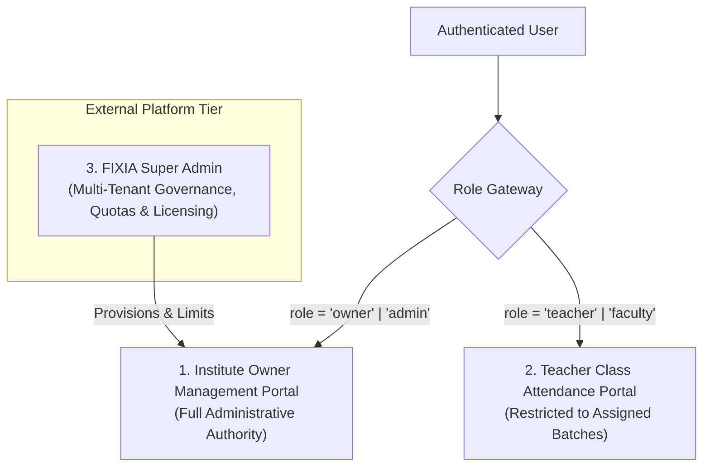

# FIXIA CoachingOS — Product Vision & Strategic Specification
**Document Version:** 1.0.0  
**Phase:** 11 — Architecture & System Audit  
**Author:** Senior SaaS Product Architect & Principal Engineer  
**Status:** Approved Architectural Blueprint  

---

## 1. Vision Statement

**FIXIA CoachingOS** is a specialized, production-ready Institute Management Operating System built specifically for Indian coaching institutes, tuition academies, test-prep centers (JEE, NEET, CUET, CA Foundation), and competitive coaching hubs.

The system replaces scattered paper registers, error-prone WhatsApp groups, and fragile Excel spreadsheets with a unified, secure, multi-tenant cloud application engineered to handle the complete academic and operational lifecycle of coaching institutes with up to 100–500 students per branch.

---

## 2. Target Market & Operational Realities

### Target Audience
- **K-12 Academic Tuition Centers:** Class 9–12 CBSE, ICSE, and State Board coaching.
- **Science & Competitive Exam Academies:** Specialized JEE Main/Advanced, NEET, and Olympiad prep institutes.
- **Commerce & Professional Training:** Class 11–12 Commerce, CA Foundation, CMA, and CS foundation classes.
- **Vocational & Language Centers:** Spoken English, IT training, and skill development academies.

### Realities of Indian Coaching Operations
1. **Single Founder/Director Authority:** The institute owner (Director) is the sole administrative, financial, and strategic authority. Owners require total control over revenue, fee dues, admissions, staff payroll, and settings.
2. **High-Velocity Lecture Transitions:** Teachers have only 3–5 minutes between consecutive batches to verify attendance. The attendance marking flow must take fewer than 30 seconds on a smartphone or tablet.
3. **Cash & UPI Dominance:** While online payment gateways exist, more than 80% of coaching fees in Tier 2 and Tier 3 cities are collected via UPI QR codes or cash at the reception desk. Instant paper and digital PDF receipt issuance is mandatory.
4. **Data Privacy Between Teachers:** Faculty members are often freelance or subject-specific (e.g., Physics specialist). Institutes strictly mandate that teachers must never see institute revenue, other teachers' student lists, or proprietary financial plans.

---

## 3. The Two Core Product Portals

FIXIA CoachingOS is partitioned into two distinct user portals, accompanied by an external platform governance interface:

---

### Portal 1: Institute Owner Management Portal
The primary administrative command center for the Institute Director and authorized operations managers.

**Key Functional Pillars:**
1. **Executive Operational Dashboard:**
   - Real-time active student enrollment counts.
   - Live daily attendance rates across all batches.
   - Monthly fee collections (Cash vs. UPI vs. Bank).
   - Total outstanding student dues.
   - Quick-action shortcuts for admissions, fee collection, and broadcasts.
2. **Student Admission & Profile Management:**
   - Single-click admission workflow with automated receipt generation.
   - Search, filter, and batch-wise student directories.
   - Guardian communication metadata (WhatsApp/SMS ready templates).
   - Soft archiving and permanent student records.
3. **Academic Batches, Timetables & Classrooms:**
   - Cohort configuration (curriculum, timing, classroom allocations, capacity).
   - Faculty assignment to batches.
   - Student transfers with historical attendance preservation.
4. **Financial Ledger, Fees & Expenses:**
   - Custom fee plan structures (Monthly, Quarterly, Full Course, Custom).
   - Manual payment recording (Cash, UPI, Cheque, Bank Transfer).
   - Automated balance recalculation ($$\text{Balance} = \text{Invoiced} - \text{Paid}$$).
   - Professional PDF & thermal printable receipts with unique sequence numbering (`RCP-2026-XXXX`).
   - Auditable payment reversals (Owner-only privilege requiring mandatory justification).
   - **Institute Expense Tracking:** Tracking overheads (rent, faculty honorariums, utilities, marketing).
5. **Staff & Faculty Account Administration:**
   - Creation and credential management for teachers and administrative staff.
   - Granular batch assignment for instructors.
   - Account activation and deactivation toggles.
6. **Reports & Audit Trail:**
   - Comprehensive CSV report generation for admissions, collections, dues, and attendance.
   - Immutable audit logs tracking admissions, payment reversals, and settings modifications.
7. **Institute Branding & Configuration:**
   - Institute name, address, registration numbers, director signature, and receipt numbering prefixes.

---

### Portal 2: Teacher Class Attendance Portal
A streamlined, high-speed, mobile-optimized attendance marking portal specifically tailored for teachers and instructors.

**Key Functional Pillars:**
1. **Assigned Batch Dashboard:**
   - Displays **only** classes and batches officially assigned to the logged-in teacher.
   - Real-time display of today's schedule, lecture timings, and assigned room numbers.
2. **Speed-Optimized Attendance Terminal:**
   - Opens the active roster of students enrolled in the selected batch.
   - Large touch targets for marking `Present`, `Absent`, or `Late`.
   - Single-tap **"Mark All Present"** for ultra-fast recording.
   - Optional student-specific remarks (e.g., "Left early", "Sick note").
   - Duplicate prevention: editing an already marked session updates the record with an audit timestamp rather than creating duplicate sessions.
3. **Teacher Attendance History:**
   - Review past attendance percentages and records for assigned classes.
   - Inspection of absent student patterns over time.
4. **Strict Security Sandboxing:**
   - **ZERO Financial Exposure:** No fee dues, payment transactions, receipt numbers, or revenue metrics are accessible.
   - **ZERO Cross-Class Exposure:** Teachers cannot view, query, or mark attendance for batches assigned to other teachers.
   - **ZERO Administrative Exposure:** Institute settings, staff accounts, subscription tiers, and audit trails are completely inaccessible.

---

### Platform Tier: FIXIA Super Admin
An isolated platform management interface for FIXIA platform operators to govern multi-tenant subscriptions, software licenses, and system health.

**Key Functional Pillars:**
1. **Tenant Provisioning & Onboarding:**
   - Review and provision new institutes.
   - Suspend or activate tenant databases.
2. **Commercial License & Quota Governance:**
   - Assign commercial models (SaaS Monthly/Annual, One-Time Perpetual License, Custom Development).
   - Enforce student capacity limits (`student_limit`) at the database trigger level.
   - Issue cryptographically verifiable license keys for offline/perpetual deployments.
3. **Platform Health & Metrics:**
   - Total tenants, total active students, aggregate platform storage, and system error rates.
   - Note: Institute owners **cannot** edit their own student limits or commercial tiers within their tenant portal.

---

## 4. UI/UX Design Direction

The user interface follows a **commercial, clean, and distraction-free design system**:

- **Color Palette:**
  - Primary: Deep Executive Navy (`#0f172a`, `#1e3a8a`, `#2563eb`).
  - Accent: High-trust Emerald Green (`#059669`, `#10b981`) for confirmed payments and attendance.
  - Warning/Dues: Alert Coral (`#dc2626`, `#fef2f2`) for overdue fees and absentees.
  - Surfaces: Clean White (`#ffffff`) and Slate Off-White (`#f8fafc`, `#f1f5f9`).
- **Typography:** Professional sans-serif typography (`Inter`, `system-ui`) with clear hierarchy, high contrast ratios, and tabular numerals for financial figures.
- **Layout Architecture:**
  - Desktop: Fixed left navigation sidebar with responsive collapsible states.
  - Mobile: Clean sticky top bar with bottom-sheet modals and touch-friendly data tables.
- **Zero Framework Bloat:** Implemented strictly in pure standard CSS with CSS variables — no Tailwind CSS or heavy utility runtimes.

